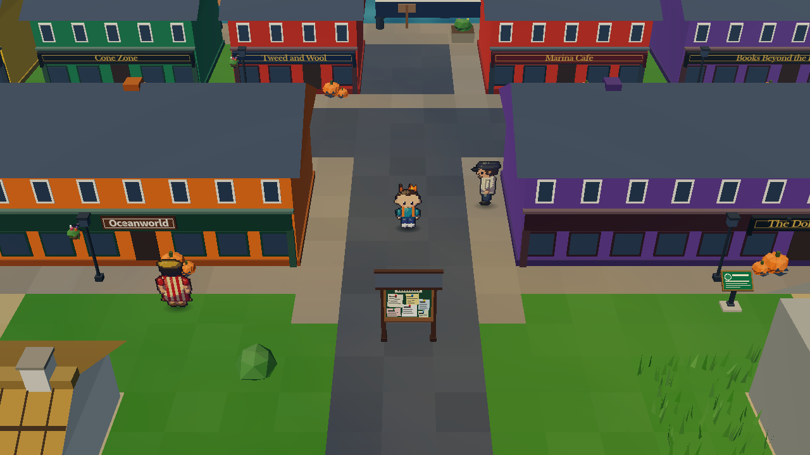
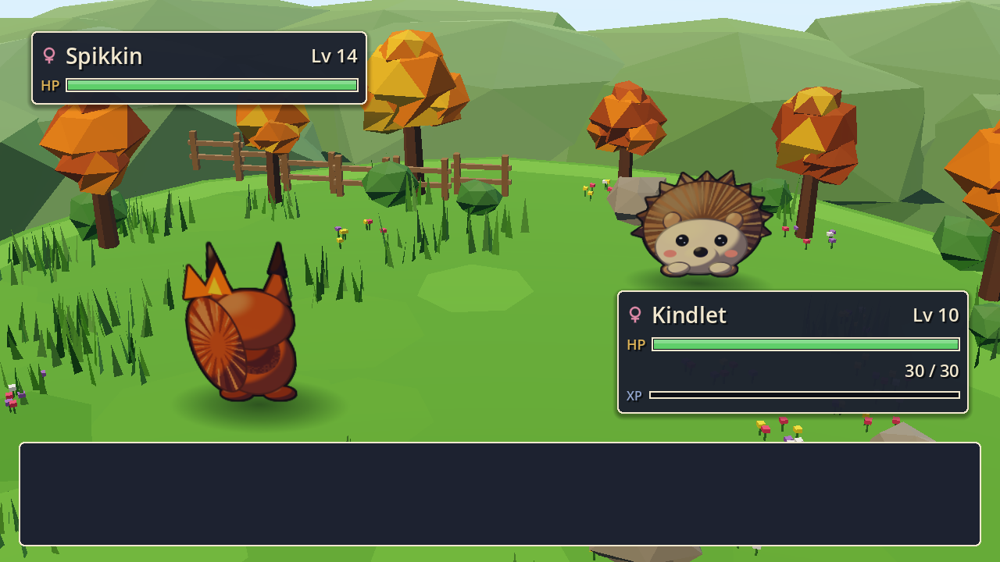
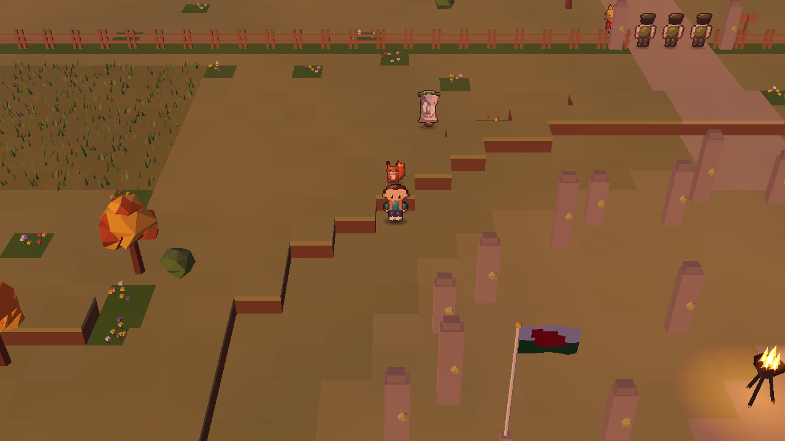
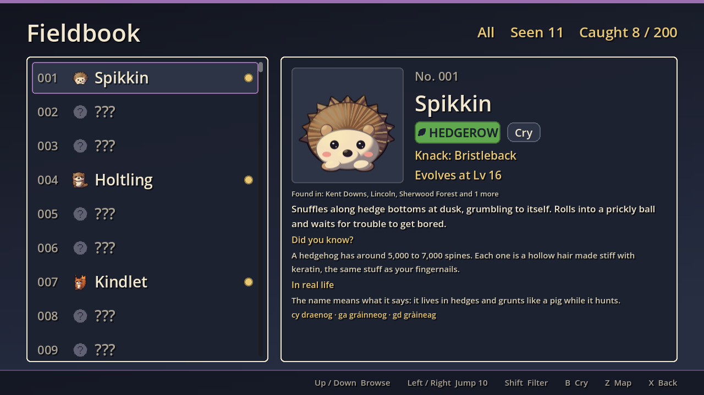
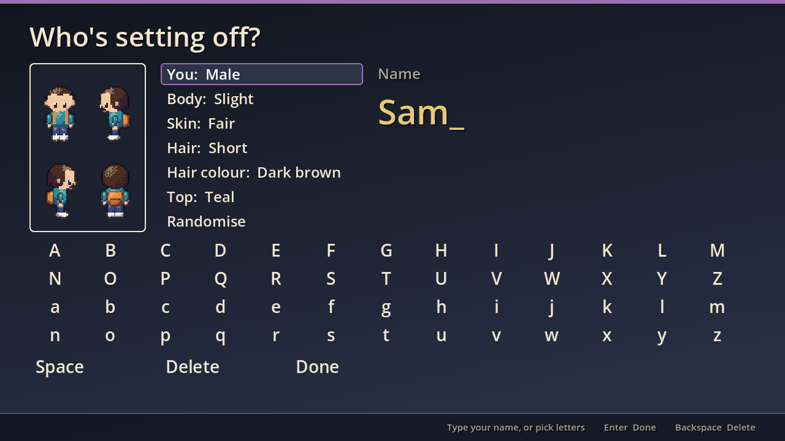
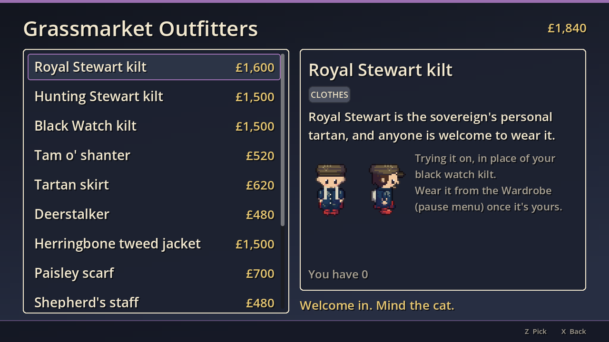

# Wildlore: These Isles

[](https://github.com/orchardroot/wildlore-these-isles/actions/workflows/ci.yml)
[](https://github.com/orchardroot/wildlore-these-isles/releases/latest)

A walking holiday round the real Isles that turns into a life there. Free, for Mac, Windows and Linux.

You leave Mum's house in Macclesfield with a hedgehog, a squirrel or an otter and a vague sense that you ought to
see a bit of the world. The world turns out to be England, Wales, Scotland, Ireland, Northern Ireland and Mann, then
Shetland and the Channel Islands, and eventually anywhere an RAF flight out of Brize Norton will take you. There are
creatures to catch, Keepers to beat and a story about someone fencing off the countryside. But mostly there are
places: real towns, real history, the right currency in your pocket and the wrong one at the bureau.

| | |
|---|---|
|  |  |
|  |  |

## Get it

**[Download the latest release](../../releases/latest)**, unzip it, and run it.

- **Mac:** right-click Wildlore.app and choose Open the first time (the builds aren't signed).
- **Windows:** click "More info", then "Run anyway".
- **Linux:** unzip, then `./Wildlore.x86_64`.

It runs at 60 fps on a 2013 iMac, so it'll be fine on yours. Saves live in your user folder and survive every
update; they always have.

## What you're in for

- **Catch creatures you could actually meet.** Two hundred in the Fieldbook and nearly four hundred counting
  evolutions, regional forms and hybrids, most of which you'd see on a decent walk if you got up early enough, plus
  the legends: Y Ddraig Goch, the Green Man, the Morrígan, Nessie, Black Shuck, Herne the
  Hunter and friends. Every one comes with a true fact about the animal or the story behind it, and its name in Welsh,
  Irish and Gaelic. Males and females look different where the real animals do, and they breed with real genetics.
- **Beat ten Keepers** in venues built from real places, from a rugby terrace in Cardiff to a candlelit crypt under
  York Minster, then the Moot at Stonehenge and a word with Lord Vane about his tower in London.
- **Walk the whole thing.** Seventy-odd towns and over eighty routes, hills and shores across the UK and Ireland,
  each built from the real place: its buildings, its food, its weather, its wildlife. Trains, ferries, a bike, a
  coracle, and eventually a raven. Then eighteen overseas destinations, from Gibraltar to the Falklands.
- **Be someone there.** Pick who you are and what you look like, then dress from fourteen boutiques: Harris Tweed,
  Fair Isle, Aran, Welsh wool, a flat cap, a kilt in a public tartan, wellies in a colour of your choosing. Shopkeepers
  notice. Buy a chippy, run a B&B, work the markets, borrow from the Building Society and regret it honestly.
- **Play what the locals play.** Darts leagues, crown green bowls, curling, the caber, hurling and shinty, sea
  shanties, conkers, crabbing, cheese rolling, bog snorkelling, a seaside arcade and a pub quiz. All at the places
  they really happen, all explained by someone who's been doing it for years.
- **Learn things by accident.** Over nine hundred heritage plaques, festivals on their real dates, the local
  language where it's spoken, optional short lessons in Welsh, Gaelic, Irish and Scots, and plain-words pages on how
  these isles actually work. None of it is homework. Sorry.

| | |
|---|---|
|  |  |

## Controls

| Action | Keyboard | Gamepad |
|---|---|---|
| Move | Arrows or WASD | D-pad or left stick |
| Run | Shift (hold) | X / West |
| Confirm / talk | Z, Enter or Space | A / South |
| Back | X or Backspace | B / East |
| Menu | Esc or Tab | Start |
| Bike on / off | B | Y / North |
| Fly (after the Moot) | F | Back / Select |
| Photo mode | P | Right stick click |

All of it can be rebound under Settings, Controls. Confirm and Back can't be swapped onto the same key, because
I've seen what happens. Larger text, a readable font, colour-blind type symbols, reduced flashing and an easier mode
for every timing minigame are under Settings, Accessibility.

## What's new

4.6 "Dressed for the Weather": your own character, clothes of these isles, creatures whose sex you can see, and
seven new minigames. The full story of every release is in [CHANGELOG.md](CHANGELOG.md).

## How it's made

Godot 4, GDScript, the Compatibility renderer. Everything is generated: the 3D world is built from text maps, the
creature and character sprites are drawn from JSON recipes, and the music is composed as note lists. No downloaded
art or audio. It's a hobby project that got out of hand, written largely with AI help (Claude) and checked by over
2,600 tests and a robot that plays the whole thing through on every release.

From source: run `tools/get_godot.sh` (it fetches the pinned Godot 4.7.2), then open the project with that binary.
`tools/test.sh` runs the tests and the data validator; `tools/playtest.sh full 1` plays the story to the credits.
Want to help? [CONTRIBUTING.md](CONTRIBUTING.md) has the house rules (UK English, real facts only, 60 fps on a 2013
iMac, never break anyone's save), and the briefs in `docs/briefs/` are where the next things are planned. Found
somewhere it breaks? The [issues page](../../issues) is open, and there's a Report a bug button on the pause menu.

It's free. If you enjoy it and want to say thanks, the best place for a few quid is the
[Electronic Frontier Foundation](https://www.eff.org/donate). Or you can tip in Ethereum: 67% of whatever lands
there goes on to the EFF, and 33% goes on coffee and cat food (Meadow has been very patient).

```
0xd2b4d9707563d238974ca0fe401becf9122a4c11
```

*orchardroot, made in Cheshire, under the supervision of two cats. Neither of them is in this one. Yet.*
